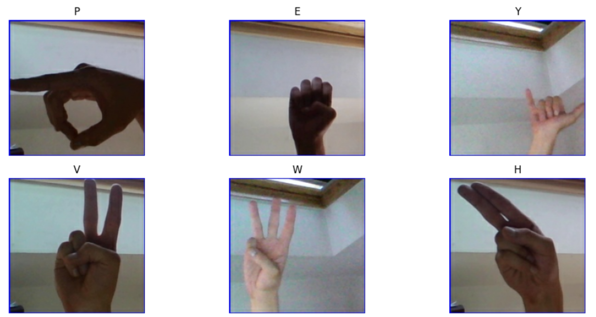
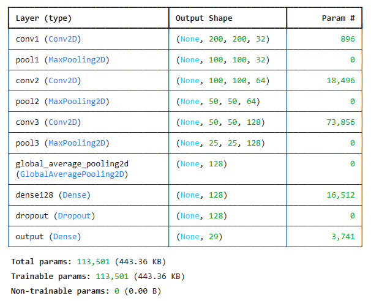
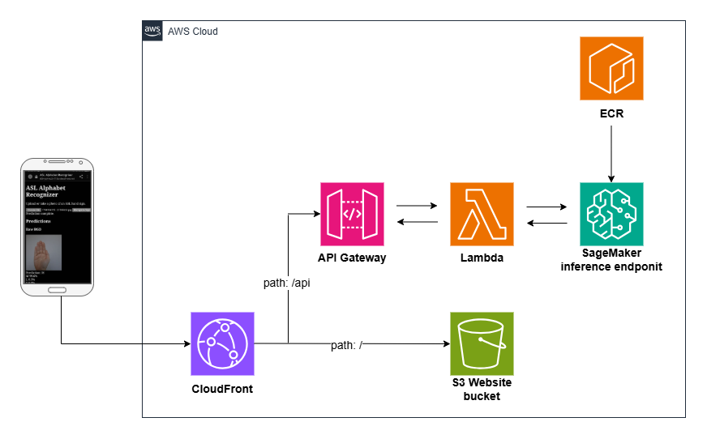
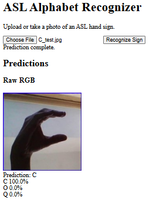

# Your first steps in Computer Vision on AWS

## [Part 1] ASL dataset + preprocessing 

⚠️ **For the detailed step-by-step explanation, read the [blog post on my website](https://daryapetrashka.com/blog/cv-asl-part-1/), or on [Dev.to](https://dev.to/dashapetr/part-1-your-first-steps-in-computer-vision-on-aws-asl-dataset-preprocessing-4h5p), or on [AWS Builder Center](https://builder.aws.com/content/3KdiKzuB4nl91kM0DfQOvjgc81k/part-1-your-first-steps-in-computer-vision-on-aws-asl-dataset-preprocessing).**

This is the first part of the series "Your first steps in Computer Vision on AWS". If you are just starting, this tutorial will guide you step by step from the initial dataset to a deployed app.

### 1. Dataset

The [ASL Alphabet dataset (Kaggle)](https://www.kaggle.com/datasets/grassknoted/asl-alphabet) comprises 87,000 training images and 29 test images. Images are 200x200 pixels and in 3-channel RGB format. The dataset has 29 classes: 26 English letters (A-Z) and 3 control signs (SPACE, DELETE, NOTHING). As you can see, it is perfectly balanced: 3,000 images per class in the training set.



### 2. Uploading to S3

For the speed, use AWS CLI. ([How to install/update AWS CLI?](https://docs.aws.amazon.com/cli/latest/userguide/getting-started-install.html))

Then run the commands to configure the appropriate concurrency (considering you have the default profile):

```
aws configure set default.s3.max_concurrent_requests 50
aws configure set default.s3.max_queue_size 10000
aws configure set default.s3.multipart_threshold 64MB
```  

Unzip the downloaded archive. To copy the files: 

```
cd archive/asl_alphabet_train
aws s3 sync ./asl_alphabet_train s3://your-bucket/raw/asl_alphabet_train/
```

⚠️ Note: if any file failed to be uploaded, use this command to find which one:

```aws s3 sync ./asl_alphabet_train s3://your-bucket/raw/asl_alphabet_train/ --dryrun```

### 3. Create SageMaker notebook instance

Since we are not training any model yet (only processing 200x200 images one at a time), a bare CPU SageMaker notebook instance with additional disk space would be enough.
I created an `ml.t3.medium` instance with a 50 GB EBS volume:

⚠️ **Don't forget to stop and terminate your instance once the data is processed and uploaded to S3.** 

### 4. Let's preprocess the data: run Jupyter notebook

Once the notebook instance is ready, you can **Open Jupyter / Open JupyterLab**.

Upload the ```data_preprocessing.ipynb``` Jupyter notebook [from the current GitHub repo](https://github.com/dashapetr/Computer_Vision_ASL_AWS/blob/main/sagemaker_notebooks/data_preprocessing.ipynb).

Run cell by cell. You might need to restart the Kernel after running pip install of libraries. (first cell)

⚠️ Don't forget to replace the placeholder and put your S3 bucket name:
```BUCKET = "YOUR-BUCKET-NAME"```

#### What it does (high-level):

1. Downloads the data from S3
2. Creates the train/validation/test split
3. Separately applies Gaussian filtering and Canny edge detection to each image
4. Uploads the preprocessed images to S3 

After uploading data to S3, your bucket should have a new ```processed/``` directory:

```
s3://YOUR-BUCKET-NAME/

processed/
├── filtered/
│   ├── train/
│   ├── validation/
│   └── test/
│
├── edges/
│   ├── train/
│   ├── validation/
│   └── test/
│
└── manifest.csv
```

## [Part 2] Training CNN from scratch

⚠️ **For the detailed step-by-step explanation, read the [blog post on my website](https://daryapetrashka.com/blog/cv-asl-part-2/), or on [Dev.to](https://dev.to/dashapetr/part-2-your-first-steps-in-computer-vision-on-aws-training-a-custom-cnn-model-1bjm), or on [AWS Builder Center](https://builder.aws.com/content/3LQMywk8ABbdx1JJcD84SbTux9j/part-2-your-first-steps-in-computer-vision-on-aws-training-a-custom-cnn-model).**

This is the second part of the series "Your first steps in Computer Vision on AWS". If you are just starting, this tutorial will guide you step by step from the initial dataset to a deployed app.

### 1. Create a GPU-powered SageMaker notebook instance

Since training on a CPU would require a lot of time (one epoch can take 1.5 hours), let's use GPU power!

The AWS `ml.g5.xlarge` SageMaker instance (and the corresponding EC2 `g5.xlarge` instance) has 1 NVIDIA A10G Tensor Core GPU with 24 GiB of VRAM (video memory).

Pricing: `ml.g5.xlarge` is not as cheap as `ml.t3.medium`. The exact price can vary depending on the region (e.g., for Frankfurt it is $1.258 per hour); see [this page for on-demand pricing reference](https://aws.amazon.com/ec2/pricing/on-demand/).

⚠️ **Don't forget to stop and terminate your instance once the data is processed and uploaded to S3.** 

### 2. Copy the image data to the instance

Once the SageMaker notebook instance is ready, you can **Open Jupyter / Open JupyterLab**.

Upload the `Raw_images_training.ipynb` Jupyter notebook [from the current GitHub repo](https://github.com/dashapetr/Computer_Vision_ASL_AWS/blob/main/sagemaker_notebooks/Raw_images_training.ipynb).

Run cell by cell.

⚠️ Don't forget to replace the placeholder and put your S3 bucket name:
```BUCKET = "YOUR_BUCKET"```

This cell copies the preprocessed data from S3 to the instance. You only need to run it once and then check that the data has been copied successfully.
```
!aws s3 sync s3://YOUR-BUCKET/raw/asl_alphabet_train/ /home/ec2-user/SageMaker/asl_alphabet_train/ --quiet
!aws s3 sync s3://YOUR-BUCKET/processed/ /home/ec2-user/SageMaker/asl_preprocessed/  --quiet
```

### 3. Train three CNN models

⚠️ Remember we had 3 versions of data: raw, Gaussian-filtered and Canny edge? Well, you can use [this `Gaussian_filtered_training.ipynb` notebook](https://github.com/dashapetr/Computer_Vision_ASL_AWS/blob/main/sagemaker_notebooks/Gaussian_filtered_training.ipynb) to train the CNN with Gaussian-filtered images; and [this `Canny_edges_training.ipynb` notebook](https://github.com/dashapetr/Computer_Vision_ASL_AWS/blob/main/sagemaker_notebooks/Canny_edges_training.ipynb) to train the CNN with Canny edge images.
They don't differ much. I created three separate notebooks mainly to keep the cell output histories separate. 

If for you it is more comfortable to use a single notebook, feel free to do it. The only thing you would need to change is the `REPRESENTATION` variable. Set it to `raw`, `filtered`, or `edges` depending on the image version. 

#### What each notebook does (high-level):

1. Creates train/validation/test dataframes
2. Designs and compiles the CNN
3. Trains the CNN from scratch
4. Evaluates on the held-out test set
5. Saves the model and uploads it to S3

Let's show the model architecture:



We are saving the **final** model, **best** model, and **training history** to S3.
After running all the cells in all three notebooks (one for each dataset version), your bucket should contain a new ```models/``` directory with the following structure:

```
s3://YOUR-BUCKET-NAME/

models/
├── asl_cnn_raw_best.keras
├── asl_cnn_raw_final.keras
├── training_history_raw.csv
├── asl_cnn_filtered_best.keras
├── asl_cnn_filtered_final.keras
├── training_history_filtered.csv
├── asl_cnn_edges_best.keras
├── asl_cnn_edges_final.keras
└── training_history_edges.csv
```

### 4. Which model is the best?

After running the notebook for 3 dataset versions (raw, Gaussian-filtered and Canny edge), it is interesting to find out which data resulted in the best model performance.

| Dataset Representation | Loss | Accuracy |
| ------ | ----------- |----------|
|Raw RGB | 0.0324 | 99.34%   |
|Canny Edges | 0.1291 | 95.51%   | 
|Gaussian Filtered | 0.2972 | 90.11%   |

It turns out that the optimal performance (highest accuracy, lowest loss) was achieved using raw RGB images.

## [Part 3] Deploying models to use in an ASL recognition app

⚠️ **For the detailed step-by-step explanation, read the [blog post on my website](https://daryapetrashka.com/blog/cv-asl-part-3/), or on [Dev.to](https://dev.to/aws-builders/part-3-your-first-steps-in-computer-vision-on-aws-deploying-models-for-an-asl-recognition-app-14hf), or on [AWS Builder Center](https://builder.aws.com/content/3LjgdHCDGt7TIUEeb7Akq6LUzgi/part-3-your-first-steps-in-computer-vision-on-aws-deploying-models-for-an-asl-recognition-app).**

This is the third and final part of the series "Your first steps in Computer Vision on AWS". If you are just starting, this tutorial will guide you step by step from the initial dataset to a deployed app.

### 1. What we are trying to build

While most ML tutorials end with model training and validation, we will take things one step further and deploy our models in an app.

Here is what the AWS architecture will look like:



The best way to test models is to take photos using a mobile phone. A simple static, serverless ASL Alphabet Recognition web application is hosted on S3 and accessed via a [CloudFront](https://aws.amazon.com/cloudfront/) URL. To call the models for predictions, we will use [API Gateway](https://aws.amazon.com/api-gateway/). A [Lambda event function](https://docs.aws.amazon.com/lambda/latest/dg/lambda-functions-chapter.html) will preprocess the uploaded photo and send it to a [serverless SageMaker inference endpoint](https://docs.aws.amazon.com/sagemaker/latest/dg/serverless-endpoints.html). The endpoint will be created using a container stored in [ECR](https://aws.amazon.com/ecr/). 

Most of the AWS infrastructure will be created automatically using [CloudFormation](https://docs.aws.amazon.com/AWSCloudFormation/latest/UserGuide/Welcome.html) (not shown on the architecture image). This will make the setup reproducible. However, we will first need to create the ECR repositories, build and push the SageMaker and Lambda container images, and upload the model archive to S3. The website files will also be uploaded to S3 manually after the stack is deployed.

### 2. Prepare models for inference

⚠️ For this step, you can use your local environment or a SageMaker notebook instance (`ml.t3.medium` is more than enough). 

Models trained in the previous part are ready: put `raw.keras`, `filtered.keras`, and `edges.keras` into `models/`.
You will also need to add the `class_names.json` file to the `models/` directory ([copy/download it from the current GitHub repo](https://github.com/dashapetr/Computer_Vision_ASL_AWS/blob/main/models/class_names.json)). 
It contains the exact class mapping used during training.

From inside `models/` directory run the command:

```
tar -czvf asl-models.tar.gz \
    raw.keras \
    filtered.keras \
    edges.keras \
    class_names.json
```
You will get the archive `asl-models.tar.gz`. Upload it to S3:

```
aws s3 cp asl-models.tar.gz \
    s3://YOUR-BUCKET/asl-app/models/asl-models.tar.gz
```

⚠️ Don't forget to replace the placeholder `YOUR-BUCKET` and put your S3 bucket name!

### 3. Build and push SageMaker inference container to ECR

⚠️ For this step, you can use your local environment with AWS CLI ([How to install/update AWS CLI?](https://docs.aws.amazon.com/cli/latest/userguide/getting-started-install.html)) or a SageMaker notebook instance (`ml.t3.medium` is more than enough). 

⚠️ Copy/download `inference.py`, `requirements.txt`, and `Dockerfile` files from the [current GitHub repo](https://github.com/dashapetr/Computer_Vision_ASL_AWS/tree/main/sagemaker). They should sit inside the `sagemaker` directory (same structure as in the repo).

Create an ECR repository and get your account ID:

```
aws ecr create-repository \
    --repository-name asl-sagemaker-inference

aws sts get-caller-identity \
    --query Account \
    --output text
```

Set variables and login:
```
export AWS_REGION=YOUR-REGION
export AWS_ACCOUNT_ID=$(aws sts get-caller-identity \
    --query Account \
    --output text)

export ECR_URI=$AWS_ACCOUNT_ID.dkr.ecr.$AWS_REGION.amazonaws.com

aws ecr get-login-password \
    --region $AWS_REGION \
    | docker login \
    --username AWS \
    --password-stdin $ECR_URI
```
Build, tag, and push:
```
cd sagemaker

docker build \
    -t asl-sagemaker-inference:latest .

docker tag \
    asl-sagemaker-inference:latest \
    $ECR_URI/asl-sagemaker-inference:latest

docker push \
    $ECR_URI/asl-sagemaker-inference:latest
```
⚠️ Make sure that your role or identity has the required permissions to do the job. Required actions: `ecr:InitiateLayerUpload`, `ecr:UploadLayerPart`, `ecr:CompleteLayerUpload`, `ecr:BatchCheckLayerAvailability`, and `ecr:PutImage`.

### 4. Build Lambda image

⚠️ For this step, you can use your local environment with AWS CLI ([How to install/update AWS CLI?](https://docs.aws.amazon.com/cli/latest/userguide/getting-started-install.html)) or a SageMaker notebook instance (`ml.t3.medium` is more than enough). 

⚠️ Copy/download `lambda_function.py`, `requirements.txt`, and `Dockerfile` files from the [current GitHub repo](https://github.com/dashapetr/Computer_Vision_ASL_AWS/tree/main/lambda). They should sit inside the `lambda` directory (same structure as in the repo).

Create a new ECR repository:
```
aws ecr create-repository \
    --repository-name asl-preprocessing-lambda
```
Get your account ID, set variables, and login:
```
aws sts get-caller-identity \
    --query Account \
    --output text

export AWS_REGION=YOUR-REGION
export AWS_ACCOUNT_ID=$(aws sts get-caller-identity \
    --query Account \
    --output text)

export ECR_URI=$AWS_ACCOUNT_ID.dkr.ecr.$AWS_REGION.amazonaws.com

aws ecr get-login-password \
    --region $AWS_REGION \
    | docker login \
    --username AWS \
    --password-stdin $ECR_URI
```
Build, tag, and push:
```
cd lambda

docker buildx build \
    --platform linux/amd64 \
    --provenance=false \
    -t asl-preprocessing-lambda:latest \
    .

docker tag asl-preprocessing-lambda:latest \
    $ECR_URI/asl-preprocessing-lambda:latest

docker push $ECR_URI/asl-preprocessing-lambda:latest
```

### 5. Deploy the CloudFormation stack

⚠️ For this step, you can use your local environment with AWS CLI ([How to install/update AWS CLI?](https://docs.aws.amazon.com/cli/latest/userguide/getting-started-install.html)) or a SageMaker notebook instance (`ml.t3.medium` is more than enough). 

⚠️ Copy/download the `cloudformation.yaml` file from the [current GitHub repo](https://github.com/dashapetr/Computer_Vision_ASL_AWS/blob/main/cloudformation.yaml).

Before deploying the stack, you will need to retrieve three values:

| Type            | Value                                                                |
|-----------------|----------------------------------------------------------------------|
| Model           | `s3://YOUR-BUCKET/asl-app/models/asl-models.tar.gz`                    |
| SageMaker image | `ACCOUNT.dkr.ecr.REGION.amazonaws.com/asl-sagemaker-inference:latest`  | 
| Lambda image    | `ACCOUNT.dkr.ecr.REGION.amazonaws.com/asl-preprocessing-lambda:latest` |

Let's deploy the stack:
```
aws cloudformation deploy \
    --template-file cloudformation.yaml \
    --stack-name asl-recognizer \
    --capabilities CAPABILITY_IAM \
    --parameter-overrides \
        ModelS3Uri=s3://YOUR-BUCKET/asl-app/models/asl-models.tar.gz \
        SageMakerImageUri=ACCOUNT.dkr.ecr.REGION.amazonaws.com/asl-sagemaker-inference:latest \
        LambdaImageUri=ACCOUNT.dkr.ecr.REGION.amazonaws.com/asl-preprocessing-lambda:latest
```
⚠️ Make sure that your role or identity has the required permissions to successfully deploy your CloudFormation stack. Required actions: `cloudformation:DescribeStacks`, `s3:CreateBucket`, `s3:ListAllMyBuckets`, `s3:GetBucketLocation`, and `apigateway:POST`.

### 6. Upload the website

⚠️ For this step, you can use your local environment with AWS CLI ([How to install/update AWS CLI?](https://docs.aws.amazon.com/cli/latest/userguide/getting-started-install.html)) or a SageMaker notebook instance (`ml.t3.medium` is more than enough). 

⚠️ Copy/download `app.js`, `index.html`, and `styles.css` files from the [current GitHub repo](https://github.com/dashapetr/Computer_Vision_ASL_AWS/tree/main/frontend). They should sit inside the `frontend` directory (same structure as in the repo).

After CloudFormation finishes, retrieve the bucket:
```
aws cloudformation describe-stacks \
    --stack-name asl-recognizer \
    --query \
    "Stacks[0].Outputs[?OutputKey=='FrontendBucket'].OutputValue" \
    --output text
```
The command will return a bucket name similar to `asl-recognizer-frontend-12000000`. Use this value to upload your website pages from the `frontend` directory to S3:
```
aws s3 sync frontend/ s3://asl-recognizer-frontend-12000000/
```
After this, retrieve the CloudFront URL:
```
aws cloudformation describe-stacks \
    --stack-name asl-recognizer \
    --query \
    "Stacks[0].Outputs[?OutputKey=='WebsiteURL'].OutputValue" \
    --output text
```
You'll get the CloudFront URL (e.g. `https://d1234567890abc.cloudfront.net`). Paste it in the browser to access your application.

### 7. Test the app

The most exciting part begins! Use your phone to take photos and make predictions.
First, I tried several images from the `asl_alphabet_test` folder, which contains additional images provided alongside the training dataset.
All three models performed reasonably well, producing the correct class predictions:



📖 **For the conclusions, read the [blog post on my website](https://daryapetrashka.com/blog/cv-asl-part-3/), or on [Dev.to](https://dev.to/aws-builders/part-3-your-first-steps-in-computer-vision-on-aws-deploying-models-for-an-asl-recognition-app-14hf), or on [AWS Builder Center](https://builder.aws.com/content/3LjgdHCDGt7TIUEeb7Akq6LUzgi/part-3-your-first-steps-in-computer-vision-on-aws-deploying-models-for-an-asl-recognition-app).**
