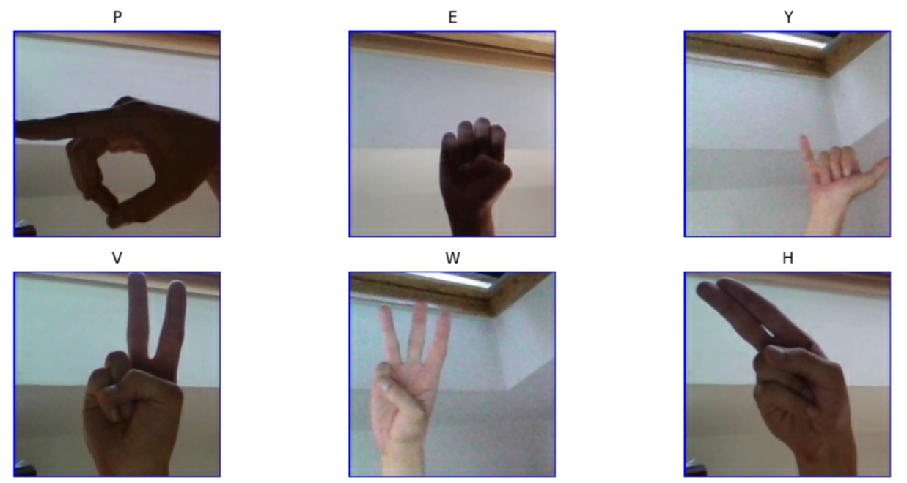

# Your first steps in Computer Vision on AWS

## [Part 1] ASL dataset + preprocessing 

⚠️ **For the detailed step-by-step explanation, read the blog post on my website or on AWS Builder Center.**

This is the first part of the series "Your first steps in Computer Vision on AWS". If you are just starting, this tutorial will guide you step by step from the initial dataset to a deployed app.

### 1. Dataset

The [ASL Alphabet dataset (Kaggle)](https://www.kaggle.com/datasets/grassknoted/asl-alphabet) comprises 87,000 training images and 29 test images. Images are 200x200 pixels and in 3-channel RGB format. The dataset has 29 classes: 26 English letters (A-Z) and 3 control signs (SPACE, DELETE, NOTHING). As you can see, it is perfectly balanced: 3,000 images per class in the training set.



### 2. Uploading to S3

For the speed, use AWS CLI. ([How to install/update AWS CLI?](https://docs.aws.amazon.com/cli/latest/userguide/getting-started-install.html))

Then run the commands to configure the appropriate concurrency (considering you have the default profile):

```
aws configure set default.s3.max_concurrent_requests 50
aws configure set default.s3.max_queue_size 10000
aws configure set default.s3.multipart_threshold 64MB
```  

Unzip the downloaded archive. To copy the files: 

```
cd archive/asl_alphabet_train
aws s3 sync ./asl_alphabet_train s3://your-bucket/raw/asl_alphabet_train/
```

⚠️ Note: if any file failed to be uploaded, use this command to find which one:

```aws s3 sync ./asl_alphabet_train s3://your-bucket/raw/asl_alphabet_train/ --dryrun```

### 3. Create SageMaker notebook instance

Since we are not training any model yet (only processing 200x200 images one at a time), a bare CPU SageMaker notebook instance with additional disk space would be enough.
I created an ```ml.t3.medium``` instance with 50 GB EBS.

⚠️ **Don't forget to stop and terminate your instance once the data is processed and uploaded to S3.** 

### 4. Let's preprocess the data: run Jupyter notebook

Once the notebook instance is ready, you can **Open Jupyter / Open JupyterLab**.

Upload the ```data_preprocessing.ipynb``` Jupyter notebook [from the current GitHub repo](https://github.com/dashapetr/Computer_Vision_ASL_AWS/blob/main/sagemaker_notebooks/data_preprocessing.ipynb).

Run cell by cell. You might need to restart the Kernel after running pip install of libraries. (first cell)

⚠️ Don't forget to replace the placeholder and put your S3 bucket name:
```BUCKET = "YOUR-BUCKET-NAME"```

#### What it does (high-level):

1. Downloads the data from S3
2. Creates the train/validation/test split
3. Separately applies Gaussian filtering and Canny edge detection to each image
4. Uploads the preprocessed images to S3 

After uploading data to S3, your bucket should have a new ```processed/``` directory:

```
s3://YOUR-BUCKET-NAME/

processed/
├── filtered/
│   ├── train/
│   ├── validation/
│   └── test/
│
├── edges/
│   ├── train/
│   ├── validation/
│   └── test/
│
└── manifest.csv
```

## [Part 2] Training CNN from scratch (to be continued...) 